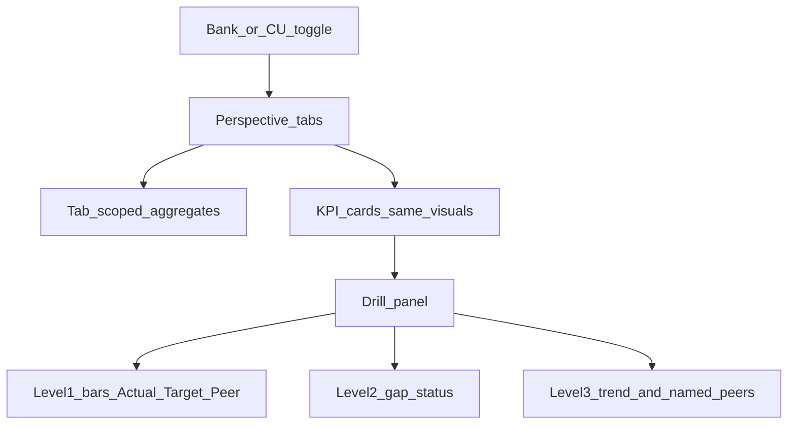

# Combined Bank / CU Objective Monitor

Build a **new** standalone HTML file in [Executive Dashboarding](c:\Users\TBaldwin\OneDrive - Jack Henry\Desktop\Executive Dashboarding) modeled strictly on [the downloaded Objective Monitor](c:\Users\TBaldwin\Downloads\community_bank_objective_monitor.html): same dark theme, cards, sparklines, progress bars, Monitor / Edit / Add modes, and the same 13 KPI slots.

Do **not** replace the existing [`community_bank_objective_monitor.html`](c:\Users\TBaldwin\OneDrive - Jack Henry\Desktop\Executive Dashboarding\community_bank_objective_monitor.html) (that copy already has extra Risk metrics).

**New file:** `community_fi_objective_monitor.html`

## What stays the same (from the download)

- Visual system: IBM Plex, `--bg/#0b0d10` cards, On track / At risk / Off track badges, 6-month sparkline vs dashed target, progress bar, Actual / Your target / vs goal boxes
- Modes: Monitor trends, Edit objectives & targets, Add objective
- Tabs: All, Financial, Customer (relabeled Member in CU mode), Internal Process, Learning & Development
- The 13 Capstone KPI cards:

  ROA, Net Operating Income, Total Deposits, Total Loans, CSI, Customer Retention, Channel Usage, Efficiency Ratio, Commercial Loan SLA, Teller Transaction SLA, Emplify Participation, Teller Turnover, Total Staff Turnover

## What gets added

### 1. Bank / Credit Union toggle (top bar)

Reuse charter rules from [`jhbi_balanced_scorecard/docs/BANK_VS_CU_FRAMEWORK.md`](c:\Users\TBaldwin\OneDrive - Jack Henry\Desktop\Executive Dashboarding\jhbi_balanced_scorecard\docs\BANK_VS_CU_FRAMEWORK.md):

- **Peer within charter.** Bank peers = $1B–$3B community bank median; CU peers = FPR / CU peer group (sample).
- Same card layout; swap **labels, targets, peer values, and a few metric names** — do not change the 13-card visual design.

Charter swaps (same slot, different name/peer/target):

| Slot (bank) | Credit union |
|---|---|
| Customer tab | Member tab |
| Total Deposits | Total Shares |
| CSI | Member Satisfaction Index |
| Customer Retention | Member Retention |
| Commercial Loan SLA | Member Business Loan SLA |
| ROA target/peer | ROA kept; CU peer ~0.66%, target ~0.80% |
| Efficiency target 52% / peer ~63% | CU target ~79% / peer ~79% (never grade CUs on a bank curve) |

### 2. Aggregate visuals on every tab

When a tab is selected (including All), show a compact aggregate strip **above** the KPI cards, scoped to that tab’s metrics. Port the patterns from [`community_bank_objective_aggregates.html`](c:\Users\TBaldwin\OneDrive - Jack Henry\Desktop\Executive Dashboarding\community_bank_objective_aggregates.html):

- Status donut (on-track share)
- Stacked on track / at risk / off track
- Average % of goal
- 6-month % of objectives on track vs target

Keep this strip visually subordinate to the KPI cards so the page still “looks like” the download.

### 3. Drillable KPI → Actual vs Target vs Peer

Clicking a card opens a drill panel (same 3-level pattern as [`community_bank_objective_peer_drill.html`](c:\Users\TBaldwin\OneDrive - Jack Henry\Desktop\Executive Dashboarding\community_bank_objective_peer_drill.html)):

1. **KPI** — comparison bars: Actual / Target / Peer
2. **Gaps** — On track vs plan, ahead/behind peer, win-both story
3. **Trend & peers** — 6-month Actual + dashed Target + Peer median; small ranked table of sample peer FIs (banks or CUs depending on toggle)

Each metric gets `peer` and `peerSeries` sample data. Status vs plan stays the existing 5% band; peer status is a separate badge on the card (“Ahead of peer” / “Behind peer”).

## Data

Inline sample series (same Mar–Aug actuals as the download). Add peer fields only; no backend. Edit/Add modes still work on the selected charter’s copy of the array (demo, not persisted).

## Wiring

- Link the new file from [`README.md`](c:\Users\TBaldwin\OneDrive - Jack Henry\Desktop\Executive Dashboarding\README.md) and [`Vibe-coding-mockups.ipynb`](c:\Users\TBaldwin\OneDrive - Jack Henry\Desktop\Executive Dashboarding\Vibe-coding-mockups.ipynb)
- Add a topbar link on the downloaded-style monitor to the existing aggregations/peer files only if useful; primary deliverable is the new combined HTML
