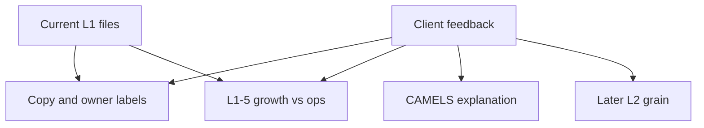

# Evaluate client feedback vs current L1 suite

The six-report IA is already close to what they endorsed. Most comments are **audience labeling, ownership of growth vs ops, and how far L1 should drill**. They are not asking for a seventh report or a new methodology.

Current surfaces live in [`l1/l1_1_enterprise_strategy.html`](l1/l1_1_enterprise_strategy.html) through [`l1/l1_6_people.html`](l1/l1_6_people.html), driven by [`l1/l1_shared.js`](l1/l1_shared.js) and the charter in [`l1/PHASE1_CHARTER_AND_OBJECTIVES.md`](l1/PHASE1_CHARTER_AND_OBJECTIVES.md).

---

## Answers to their questions

**Is CMO Chief Marketing Officer?**  
Yes. In this pack CMO is the **franchise owner**, not a campaign dashboard owner. L1-3 already goes past marketing: CSI/NPS, retention, household/member growth, core funding mix, products per HH / AMR, digital active, cross-sell, CAC. Only CAC and parts of digital/cross-sell are classic marketing. The rest is relationship value and funding quality. Treasurer still owns core mix; CMO owns the household story.

**How are CAMELS and risk controls incorporated, and how are they weighted?**  
They are **tags and a constraint rail, not a second score and not a weighted index**.

- Each proving metric has a CAMELS letter in `METRIC_DEFS` (shown on Definitions: C / A / M / E / L / S).
- Traditional BSC perspectives stay on the tiles (Financial, Customer, Internal Process, Learning & Growth). Risk is a **fifth rail**, not a fifth earnings box.
- L1-4 is the CAMELS home: C (Tier 1 / net worth), A (past due, criticized, ACL), L (LTD/LTS, wholesale), S (IRR +200 bp), M (BSA aging). Earnings (E) lives on L1-2; Management (M) also shows up on L1-3/L1-5/L1-6 (CSI, cycle, training, succession).
- L1-1 already rolls **capital** and **past due** onto the ELT page so risk is not hidden on L1-4.
- **Nothing is weighted.** Status is Actual vs **bank target** (or policy band/limit). Peer (UBPR/FPR) is context only — this matches their “targets remain primary” comment. There is no 1–5 CAMELS composite and no exam-score simulation.

**L1-2 and L1-4 “a visual would help.”**  
Those reports already exist as the same card + exception + 3-level drill layout as L1-1 (no strategy map). Point them at [`l1/l1_2_financial.html`](l1/l1_2_financial.html) and [`l1/l1_4_risk_capital.html`](l1/l1_4_risk_capital.html). No new report is required for them to comment.

---

## Report-by-report: current vs suggested

### L1-1 Enterprise Strategy — “ELT, not CEO-only”

| Current | Suggested | Gap |
|---|---|---|
| Charter already says “president/ELT open” and “board pack = this page only” | Position as ELT strategic performance | **Label only.** `REPORTS["l1-1"].owner` is `"CEO"` and the chrome prints `Owner: CEO`. Map and 9 tiles already span CFO, CMO, CRO, CHRO, Treasurer, Chief Credit. |

**Integrate:** Relabel owner to **ELT (CEO chairs)** and tweak the decision line to “leadership team visibility into overall strategic performance.” Do not add more tiles. Do not make a second ELT page.

### L1-2 Financial (CFO)

They have no content comments; they want to see the layout. Current: 8 tiles (ROA, ROE/NWG, NIM, efficiency, NOI, loan growth, deposit/share growth, fee mix), exception strip, Actual / Target / Peer, period pills. **No code change until they react to the file.**

### L1-3 Franchise (CMO)

They asked whether it is more than marketing. **Already is.** Optional copy only: subtitle that this is **franchise value** (growth, engagement, depth, funding stickiness), not a marketing-mix report. Keep CAC; it is the “are we buying volume?” check.

### L1-4 Risk & Capital (CRO)

Same as L1-2: show the HTML. Optional later: a small **CAMELS letter on each L1-4 card** (already in Definitions) so the C/A/M/E/L/S mapping is visible in Monitor mode without a weighted score.

### L1-5 Process & Growth (COO) — real IA tension

| Current on L1-5 | Client view | Reality in the catalog |
|---|---|---|
| Decision cycle, funnel, new-money yield, origination volume, cost/txn, digital self-service, commercial pipeline (CU: onboarding), teller SLA | Pipeline and production belong in sales/BD; COO should keep ops/execution | Funnel, yield, orig volume, and pipeline are already owned by **CBO** in `METRICS`. Cycle/CPT/self-service/teller SLA are **COO**. The *page* is still titled COO. |

They are right about **function**, wrong if that implies a seventh L1 report. Locked rule: six reports.

**Recommended integrate (stay at six):**

1. Retitle L1-5 to something like **Process, Service & Production** with dual owners **COO + CBO**.
2. Split the same eight cards into two groups on one page: **Operations** (cycle, CPT, self-service, teller SLA, CU onboarding) vs **Production** (funnel, new yield, origination volume, commercial pipeline).
3. Do **not** move loan/deposit *growth* — those already sit on L1-2. Pipeline is the leading indicator of that growth; it can stay on L1-5 as production, or echo as a driver on L1-2 loan growth (already does: “Commercial pipeline”).

Alternative if they insist production leave L1-5: move funnel / yield / orig_vol / pipeline onto **L1-2 or L1-3**. That overloads CFO/CMO and empties L1-5 below a useful set. Dual-owner split on L1-5 is the cleaner fit.

### L1-6 People (CHRO)

They agree. No change.

---

## Cross-cutting decisions they already agree with

| Their position | Current L1 | Action |
|---|---|---|
| Few drill layers + exceptions on the primary page | Max 3 drills; briefing = 2×2 counts + “Needs attention” rows | Keep. Do not add a fourth drill. |
| Actual vs Target vs Peer; target is primary | `statusOf` uses target/band only; peer is chip + drill gap card | Keep. Do not score tiles on peer or PY. |
| L1 stays slim; deeper metrics for dept / branch / associate | L1 is 7–9 proving metrics per report; drill 3 is named drivers + one action, not a branch table | Agree in principle; **grain they want is L2**, not more L1 tiles. |

---

## Additional considerations vs what is in the files

| Request | In L1 today | Integrate how |
|---|---|---|
| Exception reporting and notable variances | Yes — exception list + Off track / At risk badges + vs plan / vs peer on each row | Keep. Optional: one-line “largest gap” in the briefing. Do not rebuild the stacked status bar unless they ask. |
| Branch-level performance overviews | No. Teller SLA driver text mentions “L2 branch view” only. | **Do not add branch tiles on L1.** Add a **sample branch exception table inside drill level 3** for 2–3 metrics (teller SLA, origination volume, CSI) so leadership can see the coaching path. That stays one click, still 3 layers. |
| Teller and retail activity | Teller SLA (L1-5), teller/frontline turnover (L1-6). No tickets, txn counts, or lobby volume. | Keep the two enterprise teller KPIs. Retail activity counts belong in the L2 branch table, not as new L1 cards. |
| Production at branch and associate | Origination volume and pipeline are enterprise totals. | Same as branch: sample “top/bottom 5 associates” only in drill 3 on production metrics. Not a seventh report. |
| Meaningful drill for coaching | Drill 1 gaps, 2 trend/peers, 3 drivers + named action | Strengthen drill 3 with **where** (branch/associate sample) + **who coaches** (already `action.owner`). Still cap at 3. |
| Call Report / regulatory context | Definitions source lines already say Call Report / UBPR (bank) or 5300 / FPR (CU). Peers are UBPR/FPR medians. Actuals are **sample**, not live Call Report. | Keep source labels. Optional Definitions caption: “Peer context is Call Report via UBPR; we never mix UBPR and FPR.” Live warehouse bind is Phase 3, not an L1 HTML change. |

**Altitude rule to protect:** Branch and associate views are **how you explain an L1 exception**, not a second dashboard on the ELT page. Putting production scoreboards on L1-1…L1-6 would break the 8–12 tile and 3-drill limits they just endorsed.

---

## What to change in the current L1 files (if we implement)

Small, file-local work in [`l1/l1_shared.js`](l1/l1_shared.js), [`l1/l1_shared.css`](l1/l1_shared.css), and [`l1/PHASE1_CHARTER_AND_OBJECTIVES.md`](l1/PHASE1_CHARTER_AND_OBJECTIVES.md):

1. **L1-1 copy** — `owner: "ELT (CEO chairs)"`; decision text = overall strategic performance for the leadership team.
2. **L1-3 copy** — lede/owner line: franchise (growth, engagement, value), not marketing-only. Keep CMO.
3. **L1-5 ownership** — page owner `COO / CBO`; group cards into Operations vs Production; leave the eight metrics on this report.
4. **CAMELS visibility** — show the existing letter on L1-4 cards (and optionally L1-1 risk tiles). Add one sentence on Definitions: letters are tags, not weights; target remains the score.
5. **Drill 3 “where” sample** — for teller SLA, origination volume, CSI/NPS: a 4–6 row branch (and one associate) exception table. Sample data only. Other metrics keep today’s driver list.
6. **Reply to L1-2 / L1-4** — send those two HTML files; no layout invention until they comment.

Do **not**: add L1-7 Sales; add always-on branch grids; weight CAMELS; pull live Call Report; enlarge [`community_fi_objective_monitor.html`](community_fi_objective_monitor.html).
