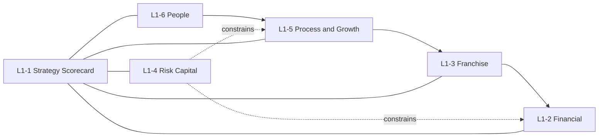

# Final six L1 strategy reports

This is the specification for the six standing executive reports a bank or credit union C-suite needs. It replaces the comparison debate. Comparison background lives in [six_l1_reports_01235cac.plan.md](c:\Users\TBaldwin\.cursor\plans\six_l1_reports_01235cac.plan.md). Metric formulas and charter notes live in [metric_catalog.json](jhbi_balanced_scorecard/data/metric_catalog.json) and [BANK_VS_CU_FRAMEWORK.md](jhbi_balanced_scorecard/docs/BANK_VS_CU_FRAMEWORK.md).

**L1 rule:** board and president altitude only. Each report is a decision surface: Actual vs Target vs Peer, MoM/YoY, named owner, as-of date. Keep **8–12 governed KPIs** per report (L1-1 may show **8–15** rollup tiles). One proving metric per objective. Relabel for charter; do not invent parallel math. Never mix UBPR and FPR on the same curve.



Enterprise cause chain: **People → Process → Franchise → Financial**. **Risk/Capital constrains** Process and Financial; it is a rail, not a fifth earnings box.

Every metric tile shows: locked formula, higher/lower-is-better, target type (goal / limit / band / floor), peer set and statistic, owner, last refresh, gap in bps (pts if |gap| ≥ 100). Drill cap is **3**: (1) KPI and gaps, (2) trend and peers, (3) drivers and named action.

---

## L1-1 through L1-6 summary

| Report Name | Owner | Cadence | Audience | Executive decision | Metrics |
|---|---|---|---|---|---|
| L1-1 Enterprise Strategy Scorecard | CEO | Monthly ELT; quarterly board | Board; ELT | Are we executing the plan, and which objective needs capital or a course correction this period? | ROA; Efficiency; CSI / NPS; Retention; Loan growth; Core funding mix; Past due 30+; Engagement |
| L1-2 Financial Performance and Earnings | CFO | Monthly ELT / ALCO; quarterly board finance | ELT; ALCO; board finance | Is growth producing acceptable, sustainable returns — and where do we reprice, cut, or invest? | ROA; ROE / Net worth growth; NIM; Efficiency; NOI vs budget; Loan growth; Deposit / share growth; Noninterest income mix |
| L1-3 Customer / Member Franchise | CMO | Monthly ELT; quarterly board franchise | ELT; board franchise | Are we deepening the relationships that fund and grow the institution, or buying volume? | CSI / NPS; Retention; Customer / member growth; Core funding mix; Products per household / AMR; Digital active; Cross-sell; CAC |
| L1-4 Balance Sheet, Risk and Capital | CRO | Monthly ALCO / risk committee; quarterly board risk | ALCO; risk committee; board risk | Is risk accumulating faster than capital, liquidity, and the control environment can absorb? | Tier 1 / Net worth; Past due 30+; Criticized assets; ACL coverage; LTD / LTS; IRR sensitivity; Wholesale reliance; BSA aging |
| L1-5 Internal Process and Growth Execution | COO | Monthly ELT ops; monthly lending committee | ELT operations; lending committee | Can the operating model originate, service, and fulfill the plan at acceptable cost, speed, and error rate? | Decision cycle; Funnel conversion; Yield on new originations; Origination volume; Cost per transaction; Digital self-service; Commercial pipeline / Onboarding cycle; Teller SLA |
| L1-6 People and Organizational Capacity | CHRO | Monthly ELT; quarterly board talent | ELT; board talent | Do we have the people and capabilities to run the strategy safely for the next 12–24 months? | Engagement; Voluntary turnover; Teller / frontline turnover; Time-to-fill critical roles; Required training completion; Succession coverage; Commercial skill coverage / Board education |

---

## Strategy maps

### L1-1 Enterprise Strategy Scorecard

This page *is* the enterprise map. Bank caption: L&D → Process → Customer → Financial (shareholder value). Risk constrains. CU caption: L&D → Process → Member → Financial (member value + net worth). Risk constrains. Sample causal line (swap with charter): bank `credit quality → provision → ROA`; CU `efficiency → capital retention → net worth`.

```text
L1-6 People          L1-5 Process           L1-3 Franchise              L1-2 Financial
Engagement, skills → Cycle time, conversion → CSI / AMR, retention  →  ROA / NOI / NIM
                                               core funding mix

                    L1-4 Risk / Capital / Controls
                    (constraint rail: capital, credit, liquidity, IRR, BSA/exam)
```

### L1-2 Financial Performance and Earnings

Bank: earn competitive ROA/ROE without stretching credit or wholesale. CU: earn enough ROA to fund net-worth growth and member value. Capital *generation* echoes here; capital *adequacy* lives on L1-4.

```text
Core funding mix (L1-3) → Cost of funds → NIM → NII
Products / AMR (L1-3)   → Fee income    → Noninterest mix → Revenue
Process efficiency (L1-5) → Expense      → Efficiency ratio
Credit quality (L1-4)     → Provision    → Net income → ROA (and ROE bank / net-worth growth CU)
Loan and deposit stock    → Volume       → NOI vs budget
```

### L1-3 Customer / Member Franchise

Banks measure household franchise depth. CUs measure member-owner depth. Relabel; do not invent parallel math.

```text
Bank:
  CSI / NPS → Retention → Household growth
  Products per HH → Cross-sell → Fee income (L1-2)
  Core deposit mix → Funding cost → NIM (L1-2)
  Digital active (franchise lens) → Primary-bank share

CU:
  Satisfaction / NPS → Retention → Member growth → Share growth (L1-2)
  AMR / products per member → Loan + share depth → NIM / ROA
  Core share mix → Cost of funds → NIM
  Onboarding quality (from L1-5) → Experience → Retention
```

### L1-4 Balance Sheet, Risk and Capital

Constraint rail (CAMELS C, A, L, S plus Management control KRIs). Three hero strips: ALM, Credit, Capital and controls.

```text
ALM strip:     Cost of funds + duration → NIM path and NII shock → Earnings (L1-2)
Credit strip:  Underwriting / concentrations → Delinquency → NCO / ACL → Provision → ROA
Capital strip: ROA and retained earnings (L1-2) → Tier 1 or net worth floor
Controls:      BSA aging, exam/DOR, cyber KRIs → Ability to stay open (CAMELS M)

Wholesale reliance and LTD/LTS sit between ALM and capital:
  Core mix (L1-3) ↓  →  Wholesale ↑  →  Liquidity and exam risk ↑
```

### L1-5 Internal Process and Growth Execution

Word-brief Growth and Pipeline content lives here as conversion, not stock.

```text
Bank:
  Commercial skill coverage (L1-6) → Pipeline conversion → Loan growth (L1-2)
  Decision cycle → Win rate / SLA → Loan growth and CSI (L1-3)
  Digital self-service + STP → Cost per transaction → Efficiency (L1-2)
  Core / channel availability → Experience → Retention (L1-3)

CU:
  Onboarding + FOM adherence → Experience → Retention and member growth
  Decision cycle → Fulfillment → Loan growth
  Efficiency discipline → Expense → Capital retention → Net worth (L1-4)
```

### L1-6 People and Organizational Capacity

A green L1-2 with a hollow bench is a lagging failure. Do not park BSA or cyber here.

```text
Engagement → Frontline stability → CSI / MSI and SLAs (L1-3, L1-5)
Training + credentials → Commercial or member-service capacity → Pipeline conversion (L1-5)
Succession on examiner-sensitive seats → Control environment (L1-4)
CU: board education hours → Governance quality → CAMELS M
CU: member education reach → NPS / member growth (L1-3)
Bank: commercial skill coverage → C&I conversion → Loan growth (L1-2)
```

---

## Operating rules for the whole suite

- **Charter toggle, one framework.** Same six reports for banks and CUs. Hide the other charter’s unique tiles. Peer within charter and size.
- **Targets are policy; peers pressure-test.** UBPR for banks, FPR / 5300 for CUs. Same as-of date and grain as Actual.
- **One number, one home.** NIM is *managed* on L1-4 and *scored as earnings quality* on L1-2. Efficiency is *scored* on L1-2 and *explained* on L1-5. Digital appears on L1-3 (adoption) and L1-5 (self-service mix) with different denominators, labeled.
- **Committees map to reports, not the other way around.** ALCO → L1-4 strip 1 + L1-2 NIM. Credit committee → L1-4 strip 2. Finance → L1-2. Lending → L1-5 funnel. Ops → L1-5 SLAs. Risk/compliance → L1-4 strip 3. HR → L1-6. Board strategy → L1-1.
- **Planning is not L1.** Add Objective / planning workspace publishes into these six. Calc QA is the gate ([BSC_IMPLEMENTATION_GUIDE.md](jhbi_balanced_scorecard/docs/BSC_IMPLEMENTATION_GUIDE.md)).
- **Not L1:** branch or region league, product P&L, marketing funnel, digital-only scorecard, cyber SOC, full ALM, BSA inventory, PMO Gantt, UBPR/FPR book, ESG unless the board mandates it.

## What “done” looks like in a meeting

```text
5 seconds   L1-1 exception strip: what needs the CEO this month
1 click     Strategy map: which perspective is breaking the chain
2nd click   The owning L1 report (L1-2 … L1-6): Actual vs Target vs Peer
3rd click   Drivers + named action (owner, due)
```

No implementation in this pass. When you want mockups, split the existing monitors into these six report shells — do not add a 47-KPI president page.

---

## Does this plan fulfill a strategic BSC for this folder?

**Answer: Yes, as architecture. Not yet as an operating scorecard.**

This plan matches what the folder researched a strategic balanced scorecard must be: Kaplan–Norton cause-and-effect, objectives proved by a few metrics, Actual vs Target vs Peer, bank/CU charter split, Risk as a CAMELS constraint rather than a sixth exam book, and L1 that answers “are we on plan / why / what do we do” without operational overload. It does **not** yet satisfy the folder’s “done when” operability list in [BSC_IMPLEMENTATION_GUIDE.md](jhbi_balanced_scorecard/docs/BSC_IMPLEMENTATION_GUIDE.md) (locked ≤12 executive KPIs, calc QA, dictionary version, published monitor). That is expected — this document is a blueprint, not a live scorecard.

### Why it fulfills the folder’s BSC definition

Checked against [README.md](README.md), [RESEARCH.md](jhbi_balanced_scorecard/docs/RESEARCH.md), [BANK_VS_CU_FRAMEWORK.md](jhbi_balanced_scorecard/docs/BANK_VS_CU_FRAMEWORK.md), [DECISIONS.md](jhbi_balanced_scorecard/docs/DECISIONS.md), [Key Metrics within Capstone Thesis.ipynb](Key%20Metrics%20within%20Capstone%20Thesis.ipynb), and [leadership_bsc_gaps_d194a4fe.plan.md](.cursor/plans/leadership_bsc_gaps_d194a4fe.plan.md):

- **Four perspectives, leading → lagging.** README and Capstone require L&D → Process → Customer → Financial. That is the enterprise map and L1-6 / L1-5 / L1-3 / L1-2. L1-1 is the rollup the leadership-gaps plan said the BSC *is* (the map, not a KPI wall).
- **Risk is first-class, not a seventh strategy.** Research and the framework elevate Risk and map it to CAMELS. L1-4 is that rail (C, A, L, S + control KRIs). The gaps plan said examiners will not grade the BSC; this plan does not turn CAMELS into six more L1 reports.
- **Bank vs CU is structural, not cosmetic.** Framework and DECISIONS require shared spine plus charter-specific Financial/Customer, UBPR vs FPR, ROA as CU capital-build fuel, no bank efficiency curve on a CU. Each report names shared / bank-only / CU-only tiles and the nomenclature map (deposits/shares, LTD/LTS, products/HH vs AMR).
- **Objective-driven monitoring, not a P&L snapshot.** Research: planning (objectives → metrics → targets → peers → calc QA → publish) is separate from monitoring. This plan keeps planning off L1 and puts owners, proving metrics, and a 3-level drill (gaps → trend/peers → drivers/action) on the monitors — the sequence the gaps plan called the product.
- **L1 altitude matches the notes.** President/board: aggregates, 5-second exceptions, 8–15 board tiles, ~12 executive-home tiles, catalog of 47 stays a dictionary. L1-1 is that home. L1-2…L1-6 are perspective scorecards, not a second catalog.
- **Capstone hero KPIs all have a home.** ROA, ROE (bank), NOI, deposits, loans, CSI, efficiency, commercial SLA, teller SLA, Emplify, teller turnover, channel/digital. Research’s original 12 (NIM, efficiency, ROA, loan growth, core mix, products/HH, digital, criticized, past due, wholesale, BSA, decision cycle) are placed, not dropped.
- **Display and peer rules are the folder’s QA rules.** Bps/pts, higherIsBetter, vs Target and vs Peer, same-charter peers — copied from RESEARCH and the implementation guide, not reinvented.
- **Leadership capabilities are specified, not more cards.** Exception strip, strategy map, driver/action drill, definition lock on the tile — the five gaps the leadership plan ranked above adding NIM/core/AMR cards. NIM, core mix, and products/HH vs AMR are included because they change the story; CRE/MBL/BSA stay off the president All-tab and on L1-4.

### Where it is incomplete vs this folder (do not pretend otherwise)

- **Operability, not design.** Implementation guide “done when”: ≤12 executive KPIs locked with owners; every KPI has formula, inputs, frequency, peer source; calc QA for the latest as-of month; ALCO and board using the same dictionary IDs; dictionary version recorded. This plan names the IDs; it does not lock, QA, or publish them.
- **L1-1 must stay a scorecard of objectives, not six metric walls.** A true BSC binds *objectives* then one proving metric. L1-2…L1-6 as written can be built as 8–12 KPI grids (48–72 tiles). That would recreate the 17-card overload the gaps plan forbade. **Rule if this is built:** L1-1 remains 8–15 objective tiles; each of L1-2…L1-6 shows only this year’s proving metrics (about 8), not the full section list.
- **Period context is only partly specified.** Gaps plan item 4: as-of, YTD vs plan, vs prior year. This plan says MoM/YoY on every tile. YTD vs plan and vs last year (the president strategic dashboard’s period pills) should be explicit on L1-1 and L1-2 before ALCO use.
- **Two Capstone / notes items are L2 or missing by design.** Capstone wanted loan **book mix** (corporate / commercial / business / retail) on the main view; this plan parks mix on L2 under L1-2 / L1-5 so L1 stays aggregates. Executive notes flagged **transaction decline % vs industry and vs peer** as high priority; that flag is not a named tile here. Treat it as an exception rule on L1-3 (franchise / channel) or L1-5 (ops), not a seventh report.
- **Asset-based planning is implied, not designed.** README value is “asset-based strategic planning.” This plan is stronger on “on plan / exception / next action” than on where to put the next dollar of capital. The strategy map and L1-4 constraint rail support that conversation; they do not yet show initiative-to-capital allocation.
- **CU net worth ratio sits on L1-4, not beside ROA on L1-2.** The framework’s CU standup says “add net worth ratio next to ROA on the financial row.” This plan puts *generation* (`net_worth_growth`) on L1-2 and *adequacy* (`net_worth_ratio`) on L1-4, which is cleaner CAMELS. For a CU board packet, echo the ratio on L1-1 / L1-2 so it does not look like capital was removed from earnings.

### Residual risks if someone “builds the six reports” literally

- Building six dense HTML pages would fight [leadership_bsc_gaps_d194a4fe.plan.md](.cursor/plans/leadership_bsc_gaps_d194a4fe.plan.md) (“stop adding metrics”). The faithful build is **one L1-1 home** plus five linked perspective reports that open from the map — reuse [community_fi_objective_monitor.html](community_fi_objective_monitor.html) and [executive_bsc_dashboard.html](executive_bsc_dashboard.html), do not clone the 47-row catalog six times.
- Efficiency lives in Capstone under Internal Process and in the catalog/research under Financial. This plan scores it on L1-2 and explains it on L1-5, which matches RESEARCH.md. Keep that split labeled so it does not look like a missing Capstone KPI.

### Bottom line

For **this folder’s research**, the plan is a complete strategic BSC *information architecture*: the four perspectives, the risk rail, the charter swap, the 12-KPI spine, the Capstone heroes, and the leadership meeting sequence. It fulfills “what L1 reports would we ever need.” It does **not** fulfill “the bank can run the scorecard next month.” That requires publishing L1-1 as an objective monitor with calc-QA’d Actual/Target/Peer, not more design.
