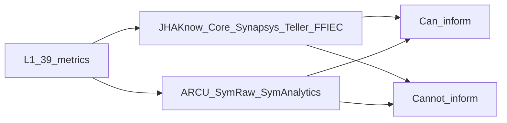

# L1 metrics vs internal Jack Henry data

Create a plan file (after approval) at [`.cursor/plans/jh_internal_l1_metric_coverage.plan.md`](.cursor/plans/jh_internal_l1_metric_coverage.plan.md) that combines two evidence sets. Do **not** change L1 HTML/JS mockups.

**Evidence**
- L1 catalog: [`l1/l1_shared.js`](l1/l1_shared.js) — 39 proving metrics
- Bank / JHAKnow: [`Metric-Analysis-Chart-JHAKnow`](Metric-Analysis-Chart-JHAKnow) — Core (`GLMAST`, `LNMAST`, …), Synapsys (101 tables), Teller/Vertex (32 tables), FFIEC/UBPR (41 tables). Score in that file: **25 yes · 6 partial · 8 no**
- CU / ARCU: [`SymRaw.bak`](SymRaw.bak) + [`SymAnalytics.bak`](SymAnalytics.bak), inventoried in [`ARCU_SYMRAW_METRIC_COVERAGE.md`](ARCU_SYMRAW_METRIC_COVERAGE.md) and [`tools/symraw/output/RESTORE_INVENTORY_SUMMARY.md`](tools/symraw/output/RESTORE_INVENTORY_SUMMARY.md)

**How to read “Jack Henry can inform”**
- **Union of products**, not a single FI install. A bank live path uses Core + Synapsys + Teller + Call/UBPR. A CU live path uses ARCU (SymAnalytics facts + SymRaw views) + 5300/FPR.
- **Can inform** = JHAKnow **yes or partial**, or ARCU **Yes or Partial**. Partial means Actual exists; budget, peer, formula lock, or a second JH table may still be required.
- **Cannot inform** = both catalogs score **no** (critical inputs are not in JH core/CRM/teller/ARCU). Needs vendor or non-JH system.
- Peers are public Call/UBPR or 5300/FPR (FFIEC tables are in JHAKnow). Do not mix UBPR and FPR.

---

## List 1 — Metrics Jack Henry **can inform** (31)

Actual (or a usable proxy) exists in JHAKnow catalogs and/or ARCU. Prefer bank objects from JHAKnow; CU objects from SymAnalytics.

### Financial (L1-2) — all 8

- `roa` — Core `GLMAST`; ARCU `edw.FactGLMonthlySnapshot`
- `roe_nwg` — Core `GLMAST` (bank ROE); ARCU GL net worth growth (CU)
- `nim` — Core `GLMAST`; ARCU GL monthly snapshot
- `efficiency` — Core `GLMAST`; ARCU GL monthly snapshot
- `noi` — **Partial:** GL Actual yes; **budget** is FP&A, not JH core (`edw.DimGoals` is not board budget)
- `loan_growth` — Core `LNMAST` / `LOAN_HISTORY_TABLE`; ARCU `FactLoanMonthlySnapshot`
- `dep_growth` — Core `DDMAST`+`CDMAST`; ARCU `FactShareMonthlySnapshot`
- `fee_mix` — Core `GLMAST` (+ `DDFEES`); ARCU GL dims

### Franchise (L1-3) — 6 of 8

- `retention` — Synapsys householding / Core `CFMAST_T`; ARCU `FactMemberSnapshot`
- `hh_growth` — Synapsys `HeadofHousehold`; ARCU `DimMember`
- `core_mix` — Core `DDMAST`+`CDMAST`; ARCU `FactShareMonthlySnapshot` + share type dims
- `depth` — Synapsys household products / Core `CFACCT`; ARCU `FactAccountSnapshot`
- `digital` — Core `HBMAST`/`HBACCT` last access (JHAKnow **yes**). ARCU sample has no digital login facts (Banno if licensed)
- `cross_sell` — Synapsys HH product counts (JHAKnow **yes**). ARCU sample has no CRM attach facts
- `cac` — **Partial:** new households in Core/Synapsys; spend only if Synapsys `MCIF_*_Budget` is used that way. ARCU: no CAC

### Risk (L1-4) — 6 of 8

- `capital` — FFIEC `RCON/UBPR7204` (bank); ARCU GL/NCUA dims (CU net worth)
- `past_due` — Core `LNPDUE`+`LNMAST`; ARCU `FactLoanMonthlySnapshot` + past-due dims
- `criticized` — Core `LNMAST` risk/watch codes (JHAKnow **yes**, bank code map). ARCU sample: no SM facts
- `acl` — FFIEC allowance `*3123` / Core nonaccrual; ARCU GL + loan snapshot (**Partial** until CECL map locked)
- `ltd` — Core loans÷deposits; ARCU loan÷share snapshots (LTS)
- `wholesale` — FFIEC brokered/wholesale MDRMs (JHAKnow). ARCU borrowed/share product codes

### Process (L1-5) — all 8 (several Partial)

- `new_yield` — Core `LNMAST` (`ORGDT`, `RATE`, `ORGAMT`); ARCU loan snapshot + rate range
- `orig_vol` — Core `LNMAST` origination amount; ARCU `FactLoanMonthlySnapshot`
- `cpt` — Teller `PTSUM`/`PTDETL` counts + `GLMAST` expense; ARCU `FactTransaction` + GL
- `self_svc` — Home banking vs Teller channel mix (JHAKnow **yes**). ARCU sample: no STP classification
- `teller_sla` — Teller `PTSUM`/`CTSESS` timestamps (JHAKnow **yes**). ARCU: volume only, not wait time
- `cycle` — **Partial:** Synapsys CRM dates, not LOS; ARCU `FactLoanApp` if timestamps populated
- `funnel` — **Partial:** Synapsys apps + Core booked; ARCU `FactLoanApp`
- `pipeline` — **Partial:** Synapsys weighted pipeline (bank C&I); ARCU member onboarding (CU), not C&I pipeline

### People (L1-6) — 2 of 7, both Partial / weak

- `turnover` — **Partial:** Synapsys `Officer` delete/visible only (not org-wide HRIS)
- `teller_to` — **Partial:** can identify tellers (`PGUSER`/`PTDWR`); **no hire/term dates** in Teller/Synapsys

---

## List 2 — Metrics Jack Henry **cannot inform** (8)

Neither JHAKnow nor ARCU contains the critical inputs. Keep **sample series** on L1 mockups; do not promise a JH-only bind.

| metric_code | L1 tile | Why JH catalogs cannot inform | Typical source |
|-------------|---------|-------------------------------|----------------|
| `csi` | CSI / NPS | No survey responses (Synapsys rating list is config only) | Raddon, Qualtrics, Medallia |
| `irr` | IRR NII +200 bp | No ALM shock engine | ProfitStars / Sendero ALM |
| `bsa` | BSA aging | No AML case aging | Yellow Hammer BSA/AML |
| `engagement` | Engagement | No employee survey | Emplify / HRIS survey |
| `ttf` | Time-to-fill | No ATS requisition/offer dates | ATS / HRIS |
| `training` | Required training | No LMS completion (ARCU Conditional only if JH education licensed; not in these catalogs) | LMS |
| `succession` | Succession coverage | No ready-now talent flags | Talent review / HRIS |
| `skill_board` | Commercial skill / board hours | No credentials or board education hours | LMS / board secretary |

JHAKnow “Still no” list is the same eight names.

---

## L1-1 board pack (9 tiles) — implication

**Can inform from JH:** `roa`, `efficiency`, `capital`, `retention`, `loan_growth`, `core_mix`, `past_due`

**Cannot inform from JH:** `csi`, `engagement`

---

## Charter caution (do not overpromise)

- **Bank first FI (Riverbend):** bind from JHAKnow Core + Synapsys + Teller + FFIEC. Do not use ARCU.
- **CU:** bind from ARCU SymAnalytics monthly facts; quarter calc-QA to 5300. Digital, cross-sell, criticized, teller SLA, self-service are **weaker in this ARCU sample** than in JHAKnow bank catalogs.
- **`noi` vs budget** and **peer medians** are not “JH operational Actual” even when the ratio is calculable.
- Mockups stay on sample data until Phase 3 warehouse bind; this document is coverage truth only.

---

## File to write on execute

[`.cursor/plans/jh_internal_l1_metric_coverage.plan.md`](.cursor/plans/jh_internal_l1_metric_coverage.plan.md) with:
1. Evidence and scoring rules (above)
2. List 1 and List 2 as tables with `metric_code`, JHAKnow score, ARCU score, primary JH objects
3. Pointers to [`Metric-Analysis-Chart-JHAKnow`](Metric-Analysis-Chart-JHAKnow) and [`ARCU_SYMRAW_METRIC_COVERAGE.md`](ARCU_SYMRAW_METRIC_COVERAGE.md)

Optional one-line pointer in [`l1_public_data_sources_90b1121e.plan.md`](.cursor/plans/l1_public_data_sources_90b1121e.plan.md) so Phase 3 uses this combined list.
