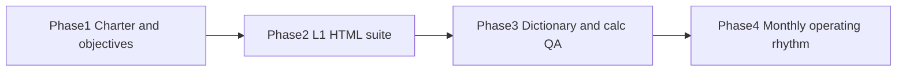

# Phased build plan — executive balanced scorecards

Spec source: [final_six_l1_reports_2784e7b8.plan.md](.cursor/plans/final_six_l1_reports_2784e7b8.plan.md). Operability gate: [BSC_IMPLEMENTATION_GUIDE.md](jhbi_balanced_scorecard/docs/BSC_IMPLEMENTATION_GUIDE.md) “done when” (≤12 L1-1 KPIs with owners, locked formulas, calc QA, charter-correct capital/franchise, same dictionary IDs on ALCO and board, dictionary version frozen).

**Guardrails for every phase**

- Exactly six L1 reports. ALM, credit, pipeline, BSA, digital, cyber stay sections or L2.
- L1-1 is 8–12 objective tiles (board pack 8–15). L1-2…L1-6 show only this year’s proving metrics (the 7–8 names in the spec table).
- Actual vs Target vs Peer; UBPR vs FPR never mixed. Planning UIs stay off L1.
- Max 3 drills. Reuse existing monitors; do not clone the 47-row catalog.
- First live FI is one charter. Keep the Bank/CU toggle on demos; do not stand up two live scorecards in the same sprint.

Phase 1 and Phase 2 can start in the same week. Phase 3 needs named owners from Phase 1. Phase 4 needs a QA-passed month from Phase 3.

---

## Phase 1 — Charter brief and this year’s objectives (days 1–15)

Non-code. Blocks a trusted live scorecard if skipped.

- Name sponsor (CEO + CFO or CEO + COO) and **one** first charter (bank or CU).
- One-page brief: peer band, UBPR or FPR, period policy (MTD / QTD / YTD / YoY), who may change a target mid-year.
- Workshop: 3–5 outcomes per L1-2…L1-6; **one proving metric** each, taken from the spec table. L1-1 is the rollup.
- Name data owners: GL, core, LOS, AML, digital, HR.
- Bind L1-1 to **8–12** objectives. Include **Tier 1 / net worth** on L1-1 (Visbanking gap). For a CU, echo net worth next to ROA.

Deliverable: charter brief + objective/metric/owner list that can be typed into the mockups.

---

## Phase 2 — Build the six linked L1 reports (first repo increment)

Productize the spec as HTML (same pattern as current demos: no build step). Do **not** add new KPI cards to [community_fi_objective_monitor.html](community_fi_objective_monitor.html). Leave [community_bank_objective_monitor.html](community_bank_objective_monitor.html) and planning mockups as planning, not L1.

**Reuse**

- Glance / period pills: [community_bank_president_strategic.html](community_bank_president_strategic.html)
- Exceptions, map, 3 drills, Bank/CU toggle: [community_fi_objective_monitor.html](community_fi_objective_monitor.html) and [community_fi_working_monitor.html](community_fi_working_monitor.html)
- Formulas: [metric_catalog.json](jhbi_balanced_scorecard/data/metric_catalog.json)

**Build**

1. **L1-1 home** — new `l1_1_enterprise_strategy.html` (or equivalent). Exception strip first; strategy map (L&D → Process → Franchise → Financial; Risk rail); 8–12 objective tiles; period pills Month / Quarter / YTD / vs prior year; hero includes ROA, Efficiency, and Tier 1 / net worth; map boxes link to L1-2…L1-6. Drill: (1) KPI and gaps, (2) trend and peers, (3) drivers and named action.
2. **L1-2…L1-6** — five linked pages (or one shell with a report switcher). Each page: report name, owner, executive decision, **only** that report’s 7–8 metric names from the spec. Charter swap on franchise, capital, pipeline vs onboarding, skill coverage vs board education.
3. **Nav** — L1-1 is the only board open. Other reports open from the map or a slim L1 switcher. Planning links stay in chrome footer, not the hero.
4. **Wire README** and [Vibe-coding-mockups.ipynb](Vibe-coding-mockups.ipynb) to the six files.

Optional in this phase (not a seventh report): annotation on a tile; transaction-decline exception on L1-3 or L1-5.

Sample data is enough. Do not block Phase 2 on BigQuery.

---

## Phase 3 — Dictionary, warehouse, calc QA (days 16–60)

Turns the suite into numbers a president will trust.

- Metric register for L1-1 plus each proving set: formula, inputs, source, average method, annualization, higherIsBetter, target type, owner, refresh, peer source, escalation. Start from [metric_catalog.json](jhbi_balanced_scorecard/data/metric_catalog.json).
- Map systems: GL/ALM → L1-2; Call Report / 5300 → capital; core/LOS → loans and cycle time; CIF/member → L1-3; AML → BSA; HRIS → L1-6; UBPR or FPR → peers.
- Extend [sql/bigquery_scorecard/](jhbi_balanced_scorecard/sql/bigquery_scorecard/): `peer_value` on the KPI fact; `charter_type` on `dim_org`; CU seed if the first FI is a CU.
- Calc QA: engine vs hand replay for the same as-of date. First-month reconcile: ROA, NIM, efficiency, capital, delinquency vs Call Report or 5300.
- Version the catalog. Formula changes require owner + QA + [DECISIONS.md](jhbi_balanced_scorecard/docs/DECISIONS.md) note.
- Starter `.pbix` (or JHBI portal) on `vw_objective_kpi_monthly` — same IDs as the HTML tiles.

Do not publish a tile that fails QA. Do not load all 47 catalog rows into the president model.

---

## Phase 4 — Soft launch and operating rhythm (days 61–90)

- Month 1: ELT and ALCO use L1-1 + L1-2 + L1-4 only. Send formula fights back to planning.
- Ritual: confirm as-of → exceptions → map → one drill → record owner / action / due → review open items next month.
- Quarter: board sees L1-1 only. Freeze the dictionary version they saw.
- Success: a decision changed, an action closed, “which number is right?” declined. Logins do not count.

**Defer after two monthly cycles:** push alerts, same-market peers, relationship profitability, risk-adjusted return, full ALM/BSA L2 packs.

---

## Suggested start-this-week order

If implementation is approved, start Phase 2 L1-1 in the repo while Phase 1 is scheduled. Do not wait for live data to build the shells. Do not expand the 17-card combined monitor.
